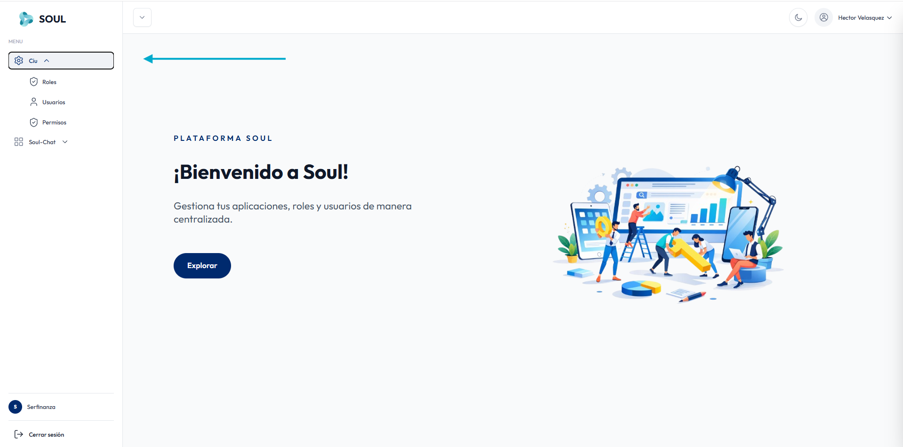

**CIU** es el módulo de administración de acceso de Soul. Desde aquí controlas **quién** puede entrar a la plataforma y **qué** puede hacer en cada aplicación (por ejemplo, Soul-Chat o Soul Voice).

Se abre desde **Ciu** en el menú lateral y se divide en tres secciones:

<CardGroup cols={3}>
  <Card title="Usuarios" icon="user" href="/ciu/usuarios">
    Crea las cuentas de las personas que usan la plataforma.
  </Card>
  <Card title="Roles" icon="shield" href="/ciu/roles">
    Define los perfiles de cada aplicación, como administrador, supervisor o agente.
  </Card>
  <Card title="Permisos" icon="key" href="/ciu/permisos">
    Asigna a cada rol las acciones que puede realizar en cada módulo.
  </Card>
</CardGroup>

## Cómo se relacionan

Los tres elementos funcionan en cadena:

1. Un **permiso** representa una acción concreta en un módulo, por ejemplo *Ver chat* (`soulchat_chat.index`).
2. Un **rol** agrupa los permisos que necesita un tipo de usuario dentro de una aplicación, por ejemplo `agente_soulchat`.
3. Un **usuario** recibe un rol, y con él, todos los permisos de ese rol.

<Steps>
  <Step title="Crea o revisa los permisos">
    En **Permisos** verifica que existan las acciones que necesitas.
  </Step>
  <Step title="Configura el rol">
    En **Roles** crea el rol para la aplicación y asígnale sus permisos desde **Permisos**.
  </Step>
  <Step title="Crea el usuario">
    En **Usuarios** registra a la persona y asígnale el rol correspondiente.
  </Step>
</Steps>

<Note>
  CIU es compartido por todas las aplicaciones de Soul. Usa el selector de aplicación en cada sección para trabajar solo con los roles y permisos de la aplicación que te interesa.
</Note>
