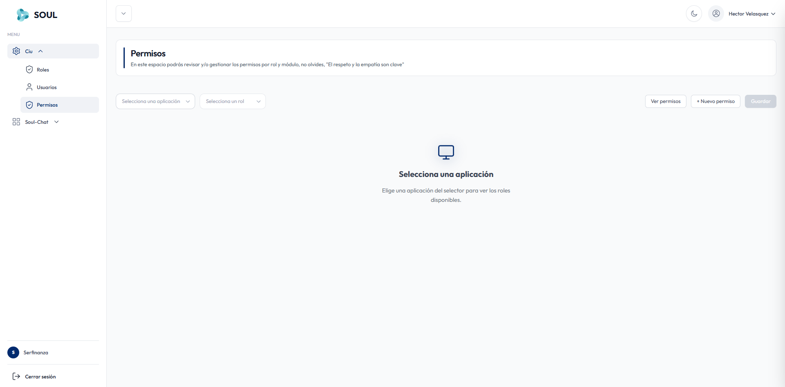
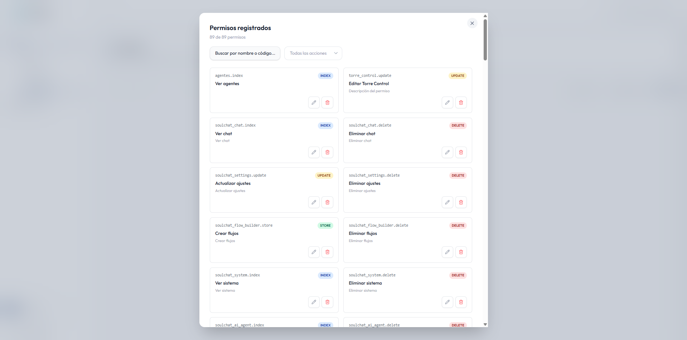
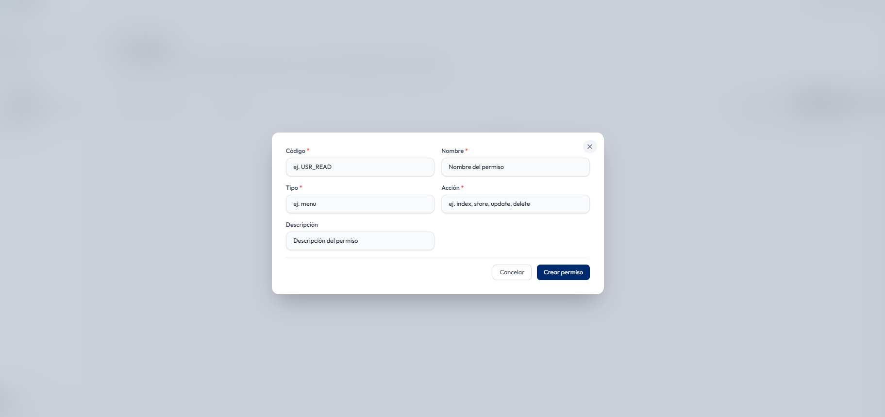

En **Ciu → Permisos** revisas y gestionas los permisos de cada rol por módulo.

## Barra de herramientas

| Control | Descripción |
| --- | --- |
| **Selecciona una aplicación** | Elige la aplicación con la que vas a trabajar. |
| **Selecciona un rol** | Elige el rol al que quieres revisar o asignar permisos. Muestra los roles de la aplicación seleccionada. |
| **Ver permisos** | Abre el catálogo de todos los permisos registrados. |
| **+ Nuevo permiso** | Crea un permiso nuevo. |
| **Guardar** | Guarda los permisos asignados al rol. Se habilita cuando haces cambios. |

Si aún no has elegido una aplicación, la pantalla muestra el mensaje *"Selecciona una aplicación"*.

## Asignar permisos a un rol

<Steps>
  <Step title="Elige la aplicación">
    Selecciónala en **Selecciona una aplicación**, por ejemplo *Soul-Chat*.
  </Step>
  <Step title="Elige el rol">
    Selecciónalo en **Selecciona un rol**, por ejemplo `agente_soulchat`.
  </Step>
  <Step title="Marca los permisos">
    Activa los permisos que el rol necesita en cada módulo.
  </Step>
  <Step title="Guarda">
    Haz clic en **Guardar** para aplicar los cambios.
  </Step>
</Steps>

## Permisos registrados

El botón **Ver permisos** abre el catálogo de permisos del sistema, con el total registrado (por ejemplo, *89 de 89 permisos*).

Puedes buscar por **nombre o código** y filtrar por tipo de acción con **Todas las acciones**. Cada permiso se muestra en una tarjeta con:

- **Código**: identificador técnico, por ejemplo `soulchat_chat.index`.
- **Acción**: etiqueta de color con el tipo de acción.
- **Nombre** y **descripción** del permiso.
- Botones **Editar** (lápiz) y **Eliminar** (papelera).

### Tipos de acción

| Acción | Significado | Ejemplo |
| --- | --- | --- |
| `INDEX` | Ver o consultar | `soulchat_chat.index` — Ver chat |
| `STORE` | Crear | `soulchat_flow_builder.store` — Crear flujos |
| `UPDATE` | Editar o actualizar | `soulchat_settings.update` — Actualizar ajustes |
| `DELETE` | Eliminar | `soulchat_system.delete` — Eliminar sistema |

<Info>
  Los códigos siguen el formato `modulo.accion`. Por ejemplo, `soulchat_flow_builder.delete` es la acción de eliminar dentro del módulo Flow Builder de Soul-Chat.
</Info>

## Crear un permiso

Haz clic en **+ Nuevo permiso** para abrir el formulario.

| Campo | Descripción |
| --- | --- |
| **Código** * | Identificador técnico del permiso, por ejemplo `USR_READ`. |
| **Nombre** * | Nombre visible del permiso. |
| **Tipo** * | Tipo de permiso, por ejemplo `menu`. |
| **Acción** * | Acción que autoriza: `index`, `store`, `update` o `delete`. |
| **Descripción** | Explicación de lo que permite hacer. |

Haz clic en **Crear permiso** para guardarlo, o en **Cancelar** para cerrar sin guardar.

<Warning>
  Eliminar un permiso lo quita de todos los roles que lo tengan asignado. Verifica antes qué roles lo usan.
</Warning>
