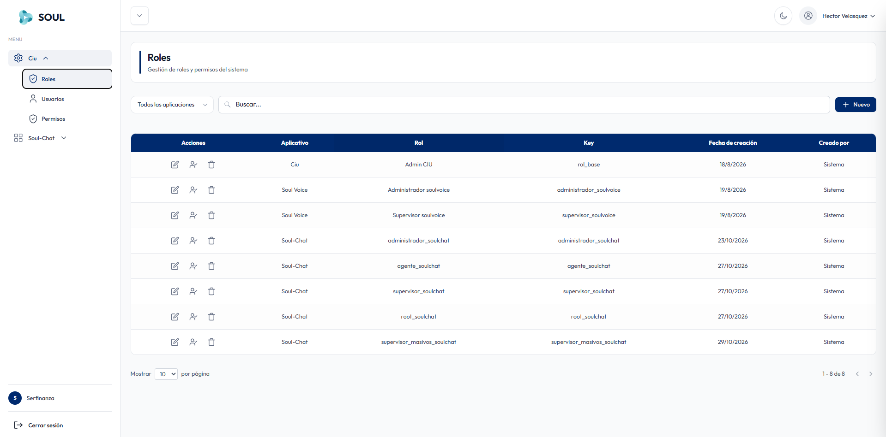
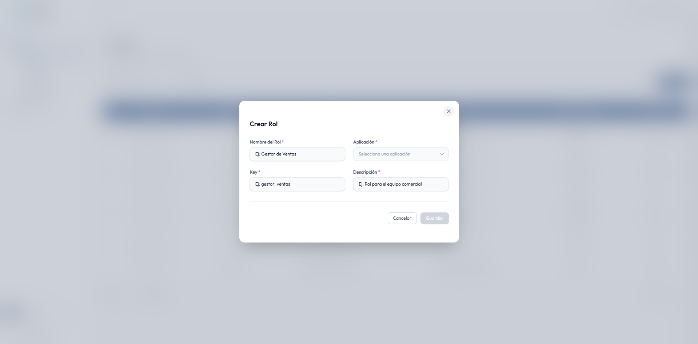

En **Ciu → Roles** gestionas los roles del sistema. Cada rol pertenece a una aplicación y define un perfil de acceso, como administrador, supervisor o agente.

## Barra de herramientas

| Control | Descripción |
| --- | --- |
| **Todas las aplicaciones** | Filtra los roles por aplicación (Ciu, Soul-Chat, Soul Voice, etc.). |
| **Buscar** | Localiza un rol por su nombre o key. |
| **+ Nuevo** | Crea un rol nuevo. |

## Tabla de roles

| Columna | Descripción |
| --- | --- |
| **Acciones** | **Editar** (lápiz), **usuarios del rol** (ícono de persona) y **Eliminar** (papelera). |
| **Aplicativo** | Aplicación a la que pertenece el rol. |
| **Rol** | Nombre visible del rol. |
| **Key** | Identificador técnico único del rol. |
| **Fecha de creación** | Fecha en que se creó el rol. |
| **Creado por** | Quién creó el rol. Los roles por defecto muestran **Sistema**. |

Al final de la tabla eliges cuántos roles ver por página (**Mostrar 10 por página**) y navegas con las flechas.

### Roles por defecto

| Aplicativo | Rol | Key |
| --- | --- | --- |
| Ciu | Admin CIU | `rol_base` |
| Soul Voice | Administrador soulvoice | `administrador_soulvoice` |
| Soul Voice | Supervisor soulvoice | `supervisor_soulvoice` |
| Soul-Chat | administrador_soulchat | `administrador_soulchat` |
| Soul-Chat | agente_soulchat | `agente_soulchat` |
| Soul-Chat | supervisor_soulchat | `supervisor_soulchat` |
| Soul-Chat | root_soulchat | `root_soulchat` |
| Soul-Chat | supervisor_masivos_soulchat | `supervisor_masivos_soulchat` |

## Crear o editar un rol

Al hacer clic en **+ Nuevo** o en **Editar**, se abre el formulario del rol.

Haz clic en **Guardar** para aplicar los cambios, o en **Cancelar** para cerrar sin guardar.

<Warning>
  El **Key** no puede modificarse una vez creado el rol. Elígelo con cuidado: usa minúsculas y guiones bajos, y sigue el formato `perfil_aplicacion`, por ejemplo `supervisor_soulchat`.
</Warning>

<Note>
  Después de crear el rol, asígnale sus permisos desde [Permisos](/ciu/permisos).
</Note>
