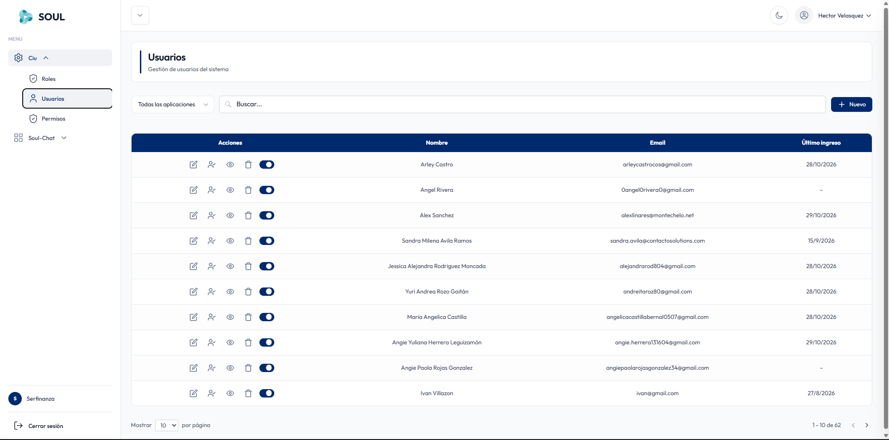
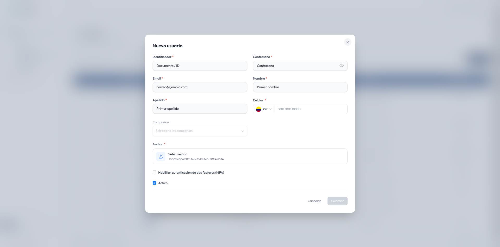

En **Ciu → Usuarios** administras las cuentas de las personas que usan la plataforma.

## Crear un usuario

Haz clic en **Nuevo** para abrir el formulario **Nuevo usuario**.

Los campos marcados con `*` son obligatorios.

| Campo | Descripción |
| --- | --- |
| **Identificador** * | Documento o ID del usuario. |
| **Contraseña** * | Contraseña de acceso. Usa el ícono de ojo para mostrarla u ocultarla. |
| **Email** * | Correo electrónico, por ejemplo `correo@ejemplo.com`. |
| **Nombre** * | Primer nombre del usuario. |
| **Apellido** * | Primer apellido del usuario. |
| **Celular** * | Número de celular con el indicativo del país (por defecto, Colombia `+57`). |
| **Compañías** | Compañías a las que pertenece el usuario. Puedes seleccionar varias. |
| **Avatar** * | Foto de perfil. Formatos JPG, PNG o WEBP, máximo 2 MB y 1024×1024 px. |
| **Habilitar autenticación de dos factores (MFA)** | Pide un segundo factor de verificación al iniciar sesión. |
| **Activo** | Si está marcado, el usuario puede iniciar sesión. Viene marcado por defecto. |

El botón **Guardar** se habilita cuando completas todos los campos obligatorios. Usa **Cancelar** para cerrar sin guardar.

<Tip>
  Activa **MFA** para los usuarios con roles administrativos, como `administrador_soulchat` o `root_soulchat`.
</Tip>

<Note>
  Para que el usuario pueda trabajar en una aplicación, debe tener un rol con los permisos necesarios. Consulta [Roles](/ciu/roles) y [Permisos](/ciu/permisos).
</Note>
