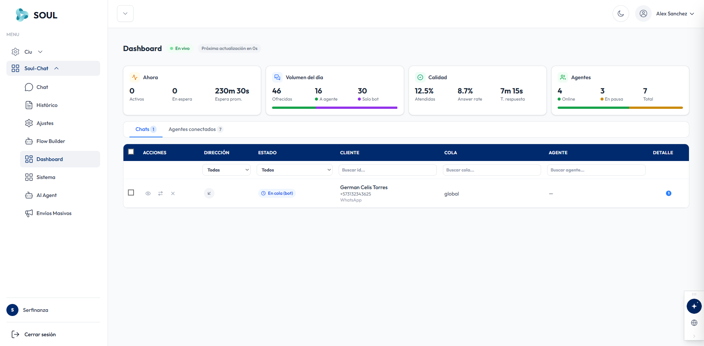

El Dashboard de SoulChat muestra las métricas operativas del canal en tiempo real. Se abre desde **Soul-Chat → Dashboard** en el menú lateral. El indicador verde **"En vivo"** junto al contador **"Próxima actualización en Xs"** confirma que los datos se actualizan automáticamente.

## Tarjetas de métricas

La parte superior agrupa los indicadores clave en cuatro tarjetas.

### Ahora

Muestra lo que está pasando en este momento.

| Métrica | Valor ejemplo | Descripción |
| --- | --- | --- |
| Activos | 0 | Conversaciones en curso en este momento |
| En espera | 0 | Conversaciones esperando ser asignadas a un agente |
| Espera prom. | 230m 30s | Tiempo promedio que el cliente espera antes de ser atendido |

### Volumen del día

Resume las conversaciones recibidas durante el día. La barra inferior muestra la proporción entre conversaciones derivadas a agente (verde) y resueltas solo por el bot (morado).

| Métrica | Valor ejemplo | Descripción |
| --- | --- | --- |
| Ofrecidas | 46 | Total de conversaciones entrantes ofrecidas al sistema |
| A agente | 16 | Conversaciones derivadas a un agente humano |
| Solo bot | 30 | Conversaciones resueltas sin intervención de un agente |

### Calidad

Indica qué tan bien se están atendiendo las conversaciones.

| Métrica | Valor ejemplo | Descripción |
| --- | --- | --- |
| Atendidas | 12.5% | Porcentaje de conversaciones atendidas |
| Answer rate | 8.7% | Tasa de respuesta dentro del nivel de servicio (SLA) |
| T. respuesta | 7m 15s | Tiempo promedio de primera respuesta |

### Agentes

Muestra el estado actual de los agentes del canal. La barra inferior muestra la proporción entre agentes en línea (verde) y en pausa (naranja).

| Métrica | Valor ejemplo | Descripción |
| --- | --- | --- |
| Online | 4 | Agentes con estado "En línea" |
| En pausa | 3 | Agentes con una pausa activa |
| Total | 7 | Total de agentes configurados en el sistema |

## Panel de conversaciones

Debajo de las tarjetas hay un panel con dos pestañas. Cada pestaña muestra un contador con la cantidad de registros, por ejemplo **Chats 1** y **Agentes conectados 7**.

### Pestaña Chats

Lista las conversaciones activas con las siguientes columnas:

| Columna | Descripción |
| --- | --- |
| Casilla de selección | Permite seleccionar una o varias conversaciones; la casilla del encabezado las selecciona todas |
| ACCIONES | Botones de acción rápida: ver la conversación (ojo), transferirla (flechas) y cerrarla (X) |
| DIRECCIÓN | Ícono que indica si la conversación es entrante (inbound) o saliente (outbound) |
| ESTADO | Estado actual de la conversación, por ejemplo **En cola (bot)** |
| CLIENTE | Nombre del cliente, número de teléfono y canal (por ejemplo, WhatsApp) |
| COLA | Cola a la que está asignada la conversación, por ejemplo `global` |
| AGENTE | Agente responsable; muestra "—" si aún no tiene uno asignado |
| DETALLE | Indicador numérico azul con información adicional de la interacción |

Filtros disponibles en la pestaña Chats:

| Filtro | Descripción |
| --- | --- |
| Dirección | Filtra por Todas, inbound u outbound |
| Estado | Filtra por estado de la conversación (por defecto, Todos) |
| Buscar id | Localiza una conversación por su identificador |
| Buscar cola | Localiza por nombre de cola |
| Buscar agente | Localiza por nombre de agente |

### Pestaña Agentes conectados

Muestra la lista de agentes conectados en este momento, para supervisar la disponibilidad operativa en tiempo real.
