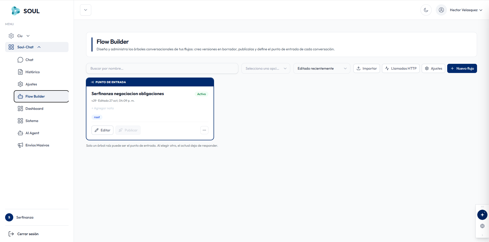
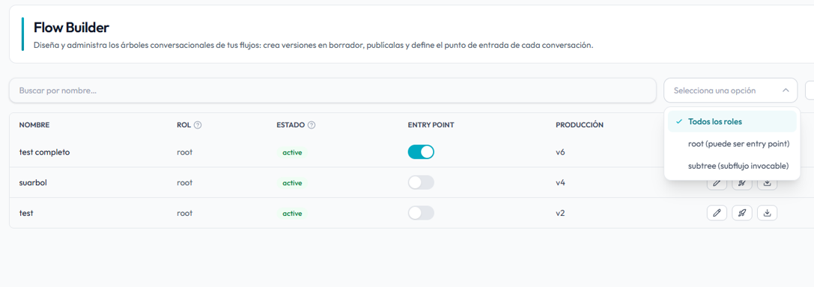
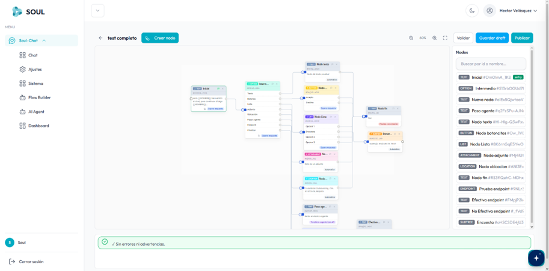
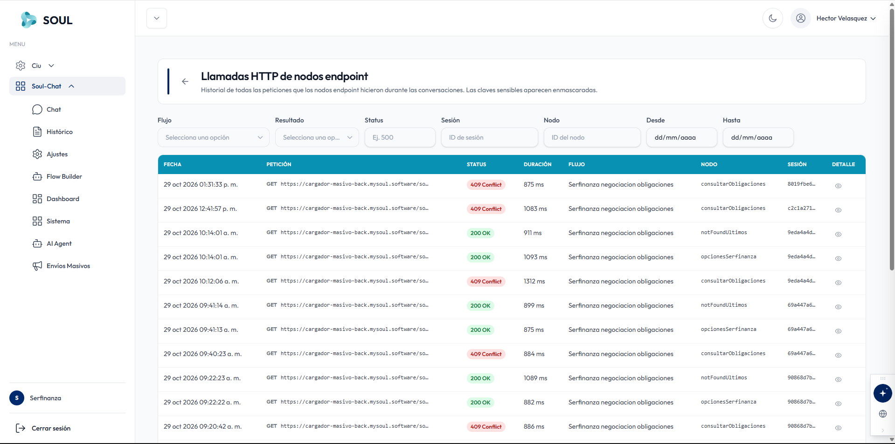
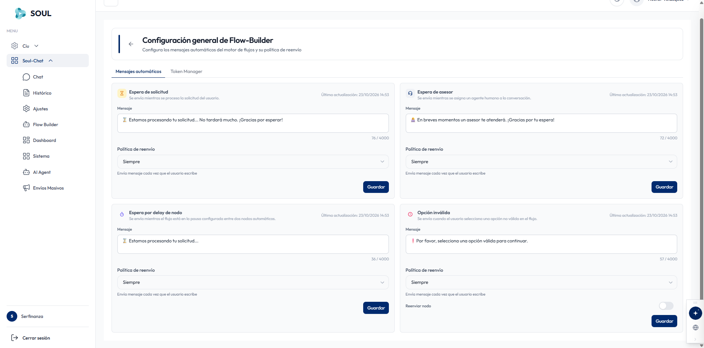
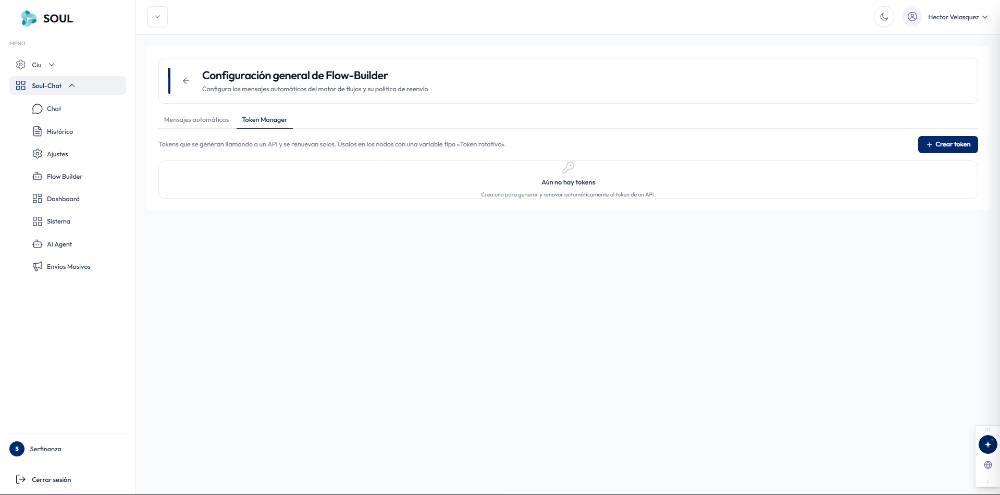
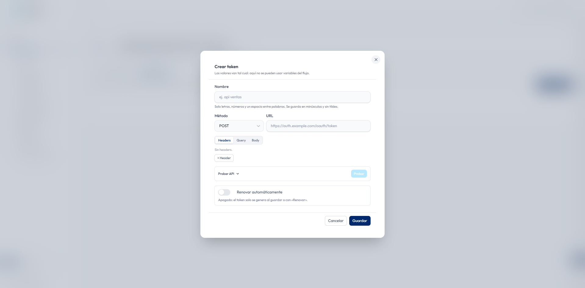

Flow Builder es el módulo de diseño de árboles conversacionales de SoulChat. Desde aquí creas versiones en borrador, las publicas y defines el punto de entrada de cada conversación. Se abre desde **Soul-Chat → Flow Builder** en el menú lateral.

## Barra de herramientas

| Control | Descripción |
| --- | --- |
| **Buscar por nombre** | Localiza un flujo por su nombre. |
| **Selecciona una opción** | Filtra los flujos por rol (ver [Filtrar por rol](#filtrar-por-rol)). |
| **Editado recientemente** | Ordena la lista de flujos. Por defecto muestra primero los editados más recientemente. |
| **Importar** | Carga un flujo desde un archivo. |
| **Llamadas HTTP** | Abre el historial de peticiones de los nodos endpoint (ver [Llamadas HTTP](#llamadas-http-de-nodos-endpoint)). |
| **Ajustes** | Abre la configuración general de Flow-Builder (ver [Configuración general](#configuracion-general-de-flow-builder)). |
| **Nuevo flujo** | Crea un flujo nuevo. |

## Tarjetas de flujos

Cada flujo se muestra como una tarjeta con su información y acciones.

| Elemento | Descripción |
| --- | --- |
| **Encabezado "PUNTO DE ENTRADA"** | Aparece solo en el flujo que recibe las conversaciones entrantes. |
| **Nombre** | Nombre del flujo, por ejemplo _Serfinanza negociacion obligaciones_. |
| **Estado** | Etiqueta de estado, por ejemplo **Activo** (verde). |
| **Versión y fecha** | Versión actual y fecha de la última edición, por ejemplo `v29 · Editado 27 oct, 04:09 p. m.` |
| **\+ Agregar nota** | Permite agregar una nota descriptiva al flujo. |
| **Rol** | Etiqueta con el rol del flujo: `root` o `subtree`. |
| **Editar** | Abre el editor visual del flujo. |
| **Publicar** | Publica la versión en borrador a producción. Aparece deshabilitado cuando no hay cambios pendientes por publicar. |
| **⋯ (más opciones)** | Muestra acciones adicionales del flujo. |

<Warning>
  Solo un árbol raíz (`root`) puede ser el punto de entrada. Al elegir otro, el actual deja de responder.
</Warning>

## Filtrar por rol

El selector **"Selecciona una opción"** permite filtrar la lista por tipo de flujo.

<AccordionGroup>
  <Accordion title="Todos los roles (por defecto)">
    Muestra todos los flujos sin importar su rol.
  </Accordion>

  <Accordion title="root (puede ser entry point)">
    Filtra solo flujos principales que pueden activarse como punto de entrada de conversaciones entrantes.
  </Accordion>

  <Accordion title="subtree (subflujo invocable)">
    Filtra flujos secundarios diseñados para ser invocados desde otro flujo mediante un nodo de transferencia.
  </Accordion>
</AccordionGroup>

## Crear un nuevo flujo

<Steps>
  <Step title="Inicia la creación">
    Haz clic en el botón **\+ Nuevo flujo** en la esquina superior derecha.
  </Step>
  <Step title="Asigna un nombre">
    Ingresa un nombre descriptivo para el flujo.
  </Step>
  <Step title="Selecciona el rol">
    Elige `root` si será un flujo principal, o `subtree` si será un subflujo invocable desde otro flujo.
  </Step>
  <Step title="Abre el editor visual">
    El flujo se crea en estado borrador. Haz clic en **Editar** para abrir el editor visual.
  </Step>
  <Step title="Diseña el árbol conversacional">
    Añade nodos al flujo: mensajes, condiciones, transferencias y acciones según la lógica de tu conversación.
  </Step>
  <Step title="Publica el flujo">
    Cuando el flujo esté listo, haz clic en **Publicar** para generar una nueva versión de producción.
  </Step>
</Steps>

## Editor visual de flujos

Al hacer clic en **Editar** en cualquier flujo, se abre el editor visual de árboles conversacionales.

### Barra de herramientas superior

| Control | Descripción |
| --- | --- |
| **Crear nodo** | Agrega un nuevo nodo al canvas del flujo |
| Zoom (%) | Ajusta el nivel de zoom del canvas (ej: 60%) |
| **Validar** | Verifica que el flujo no tenga errores de configuración |
| **Guardar draft** | Guarda el estado actual como borrador sin publicar |
| **Publicar** | Publica el flujo en producción como nueva versión |

### Panel de nodos disponibles

El panel derecho muestra todos los tipos de nodos que puedes agregar al flujo:

| Tipo | Etiqueta | Descripción |
| --- | --- | --- |
| TEXT | Inicial | Nodo de entrada principal del flujo (solo puede haber uno) |
| OPTIONS | Intermedio | Presenta opciones al usuario y ramifica según la respuesta |
| TEXT | Nuevo nodo | Nodo de texto genérico para mensajes informativos |
| TEXT | Paso agente | Transfiere la conversación a un agente humano |
| TEXT | Nodo texto | Envía un mensaje de texto simple al usuario |
| BUTTON | Nodo botoncitos | Presenta botones interactivos al usuario |
| LIST | Nodo Lista | Muestra una lista de opciones desplegable |
| ATTACHMENT | Nodo adjunto | Envía un archivo adjunto (imagen, documento, etc.) |
| LOCATION | Nodo ubicacion | Solicita o envía una ubicación geográfica |
| TEXT | Nodo fin | Cierra el flujo conversacional |
| ENDPOINT | Prueba endpoint | Llama a una API externa en modo prueba |
| TEXT | Efectivo endpoint | Rama de respuesta exitosa de un endpoint |
| TEXT | No Efectivo endpoint | Rama de respuesta fallida de un endpoint |
| SUBTREE | Encuesta | Invoca el subflujo de encuesta de satisfacción |

### Barra de estado inferior

La barra inferior indica el estado de validación del flujo en tiempo real. El mensaje **`✓ Sin errores ni advertencias.`** confirma que el flujo puede publicarse.

<Note>
  El botón **Publicar** solo genera una nueva versión de producción si el flujo pasa la validación. Si hay errores, corrige los nodos señalados antes de publicar.
</Note>

## Llamadas HTTP de nodos endpoint

Desde el botón **Llamadas HTTP** abres el historial de todas las peticiones que los nodos endpoint hicieron durante las conversaciones. Las claves sensibles aparecen enmascaradas. Usa la flecha **←** para volver a Flow Builder.

### Filtros

| Filtro | Descripción |
| --- | --- |
| **Flujo** | Muestra solo las llamadas de un flujo. |
| **Resultado** | Filtra por resultado de la petición. |
| **Status** | Filtra por código HTTP, por ejemplo `500`. |
| **Sesión** | Busca por ID de sesión. |
| **Nodo** | Busca por ID del nodo. |
| **Desde / Hasta** | Limita el rango de fechas (`dd/mm/aaaa`). |

### Tabla de llamadas

| Columna | Descripción |
| --- | --- |
| **FECHA** | Fecha y hora de la petición. |
| **PETICIÓN** | Método HTTP (por ejemplo `GET`) y URL llamada. |
| **STATUS** | Código de respuesta. En verde las exitosas (`200 OK`) y en rojo los errores (por ejemplo `409 Conflict`). |
| **DURACIÓN** | Tiempo de respuesta en milisegundos. |
| **FLUJO** | Flujo desde el que se hizo la llamada. |
| **NODO** | Nodo endpoint que hizo la petición, por ejemplo `consultarObligaciones`. |
| **SESIÓN** | ID de la sesión de la conversación. |
| **DETALLE** | Ícono de ojo para ver el detalle completo de la petición y la respuesta. |

<Tip>
  Filtra por **Sesión** para revisar todas las llamadas de una misma conversación y entender en qué paso falló una integración.
</Tip>

## Configuración general de Flow-Builder

Desde el botón **Ajustes** configuras los mensajes automáticos del motor de flujos y su política de reenvío. La pantalla tiene dos pestañas: **Mensajes automáticos** y **Token Manager**.

### Mensajes automáticos

Hay cuatro mensajes automáticos. Cada uno muestra la fecha de su última actualización.

| Mensaje | Cuándo se envía | Mensaje por defecto |
| --- | --- | --- |
| **Espera de solicitud** | Mientras se procesa la solicitud del usuario. | ⏳ Estamos procesando tu solicitud... No tardará mucho. ¡Gracias por esperar! |
| **Espera de asesor** | Mientras se asigna un agente humano a la conversación. | En breves momentos un asesor te atenderá. ¡Gracias por tu espera! |
| **Espera por delay de nodo** | Mientras el flujo está en la pausa configurada entre dos nodos automáticos. | ⏳ Estamos procesando tu solicitud... |
| **Opción inválida** | Cuando el usuario selecciona una opción no válida en el flujo. | ❗ Por favor, selecciona una opción válida para continuar. |

Cada tarjeta tiene estos campos:

| Campo | Descripción |
| --- | --- |
| **Mensaje** | Texto que se envía al usuario. Admite hasta 4000 caracteres; el contador aparece debajo del campo. |
| **Política de reenvío** | Define cuándo se vuelve a enviar el mensaje. Con **Siempre**, se envía cada vez que el usuario escribe. |
| **Reenviar nodo** | Solo en **Opción inválida**. Interruptor para volver a enviar el nodo actual después del mensaje. |
| **Guardar** | Guarda los cambios de esa tarjeta. Cada mensaje se guarda por separado. |

### Token Manager

Aquí administras tokens que se generan llamando a un API y se renuevan solos. Úsalos en los nodos con una variable de tipo **«Token rotativo»**.

Si todavía no hay tokens, aparece el mensaje _"Aún no hay tokens"_. Para crear uno, haz clic en **\+ Crear token**.

#### Crear token

<Note>
  Los valores del formulario se envían tal cual: aquí **no** se pueden usar variables del flujo.
</Note>

| Campo | Descripción |
| --- | --- |
| **Nombre** | Identificador del token, por ejemplo `api ventas`. Solo admite letras, números y un espacio entre palabras. Se guarda en minúsculas y sin tildes. |
| **Método** | Método HTTP de la petición que genera el token. Por defecto, `POST`. |
| **URL** | Dirección del servicio que entrega el token, por ejemplo `https://auth.example.com/oauth/token`. |
| **Headers / Query / Body** | Pestañas para agregar los encabezados, parámetros de consulta y cuerpo de la petición. Usa **\+ Header** para agregar un encabezado. |
| **Probar API** | Sección desplegable con el botón **Probar** para verificar la petición antes de guardar. |
| **Renovar automáticamente** | Interruptor para que el token se renueve solo. Si está apagado, el token solo se genera al guardar o con el botón **Renovar**. |

Haz clic en **Guardar** para crear el token, o en **Cancelar** para cerrar sin guardar.

<Tip>
  Usa **Probar API** antes de guardar para confirmar que la URL, los headers y el body son correctos.
</Tip>
