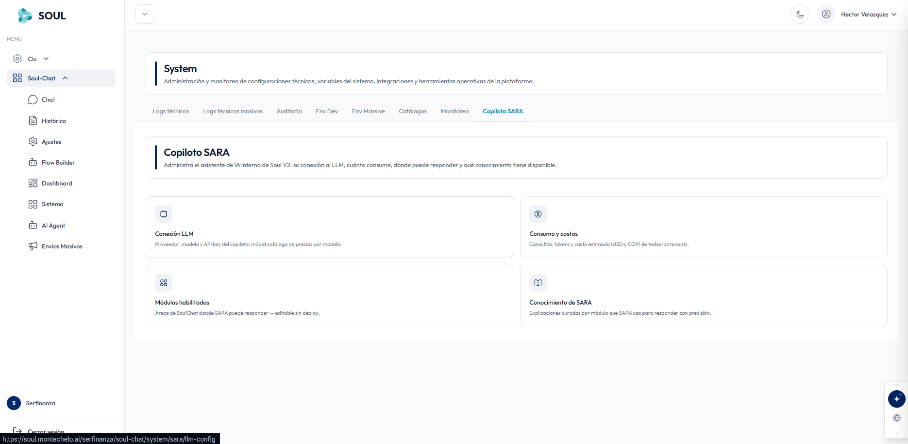
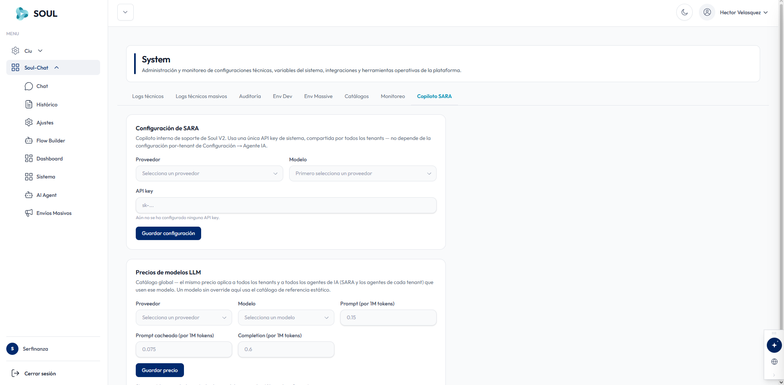
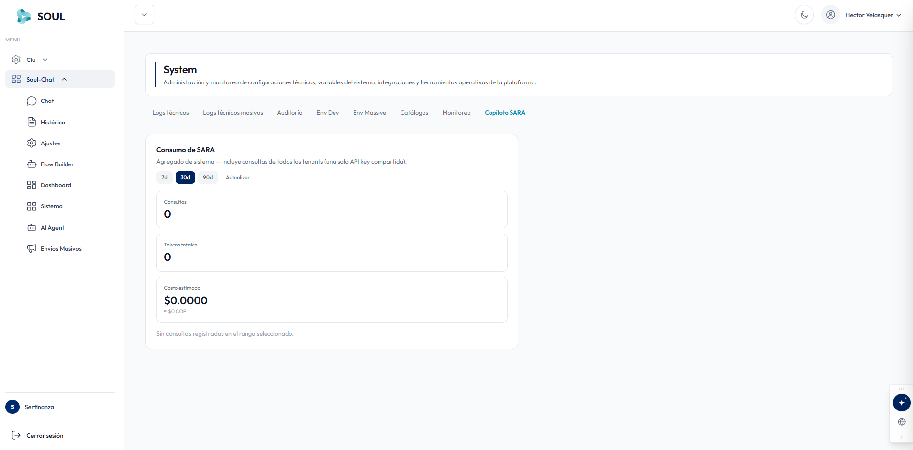
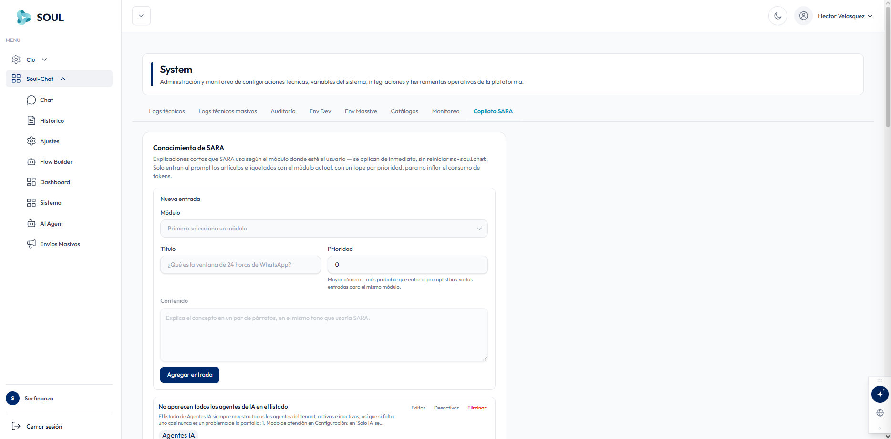

**SARA** es el copiloto de IA interno de Soul V2. Desde **Sistema → Copiloto SARA** administras su conexión al LLM, cuánto consume y qué conocimiento tiene disponible.

La vista principal muestra tres tarjetas, una por cada sección:

<CardGroup cols={3}>
  <Card title="Conexión LLM" icon="microchip">
    Proveedor, modelo y API key del copiloto, más el catálogo de precios por modelo.
  </Card>
  <Card title="Consumo y costos" icon="circle-dollar-sign">
    Consultas, tokens y costo estimado (USD y COP) de todos los tenants.
  </Card>
  <Card title="Conocimiento de SARA" icon="book-open">
    Explicaciones por módulo que SARA usa para responder con precisión.
  </Card>
</CardGroup>

<Tabs>
  <Tab title="Conexión LLM">
    

    ## Configuración de SARA

    SARA usa **una única API key de sistema, compartida por todos los tenants**. No depende de la configuración por tenant de **Configuración → Agente IA**.

    | Campo | Descripción |
    | --- | --- |
    | **Proveedor** | Proveedor del LLM que usará SARA. |
    | **Modelo** | Modelo del proveedor. Se habilita después de seleccionar un proveedor. |
    | **API key** | Llave del proveedor (formato `sk-...`). Si no hay una guardada, aparece el mensaje *"Aún no se ha configurado ninguna API key"*. |

    Haz clic en **Guardar configuración** para aplicar los cambios.

    ## Precios de modelos LLM

    Es un **catálogo global**: el precio que definas aplica a todos los tenants y a todos los agentes de IA que usen ese modelo, tanto SARA como los agentes de cada tenant. Un modelo sin precio personalizado aquí usa el catálogo de referencia estático.

    | Campo | Valor ejemplo | Descripción |
    | --- | --- | --- |
    | **Proveedor** | — | Proveedor del modelo. |
    | **Modelo** | — | Modelo al que se le asigna el precio. |
    | **Prompt (por 1M tokens)** | 0.15 | Precio por millón de tokens de entrada. |
    | **Prompt cacheado (por 1M tokens)** | 0.075 | Precio por millón de tokens de entrada que vienen de caché. |
    | **Completion (por 1M tokens)** | 0.6 | Precio por millón de tokens de respuesta. |

    Haz clic en **Guardar precio** para registrar el valor.

    <Note>
      Estos precios son la base para calcular el costo estimado que aparece en la pestaña **Consumo y costos**.
    </Note>
  </Tab>

  <Tab title="Consumo y costos">
    

    ## Consumo de SARA

    Muestra el **agregado de todo el sistema**: incluye las consultas de todos los tenants, porque todos comparten la misma API key.

    Usa los botones **7d**, **30d** o **90d** para elegir el rango de días, y **Actualizar** para recargar los datos.

    | Métrica | Descripción |
    | --- | --- |
    | **Consultas** | Número de consultas hechas a SARA en el rango seleccionado. |
    | **Tokens totales** | Tokens consumidos en esas consultas. |
    | **Costo estimado** | Costo en USD, con su equivalente aproximado en COP debajo. |

    Si no hay datos, aparece el mensaje *"Sin consultas registradas en el rango seleccionado"*.
  </Tab>

  <Tab title="Conocimiento de SARA">
    

    ## Conocimiento de SARA

    Son explicaciones cortas que SARA usa según el módulo donde esté el usuario. Se aplican **de inmediato**, sin reiniciar `ms-soulchat`.

    <Info>
      Solo entran al prompt los artículos etiquetados con el módulo actual, con un tope por prioridad. Así se evita inflar el consumo de tokens.
    </Info>

    ### Nueva entrada

    | Campo | Descripción |
    | --- | --- |
    | **Módulo** | Módulo de SoulChat al que pertenece la explicación. |
    | **Título** | Pregunta o tema que cubre la entrada, por ejemplo *"¿Qué es la ventana de 24 horas de WhatsApp?"*. |
    | **Prioridad** | Número entero. Un número mayor hace más probable que la entrada entre al prompt cuando hay varias para el mismo módulo. |
    | **Contenido** | Explicación del concepto en un par de párrafos, en el mismo tono que usaría SARA. |

    Haz clic en **Agregar entrada** para guardarla.

    ### Entradas existentes

    Debajo del formulario aparece la lista de entradas creadas. Cada una muestra su título, un resumen del contenido y la etiqueta del módulo (por ejemplo, **Agentes IA**), junto con tres acciones:

    | Acción | Descripción |
    | --- | --- |
    | **Editar** | Modifica el contenido de la entrada. |
    | **Desactivar** | Deja de usar la entrada sin borrarla. |
    | **Eliminar** | Borra la entrada. |

    <Tip>
      Escribe entradas cortas y concretas. Como solo entran unas pocas por módulo, usa la prioridad para asegurar que las más importantes siempre lleguen al prompt.
    </Tip>
  </Tab>
</Tabs>
