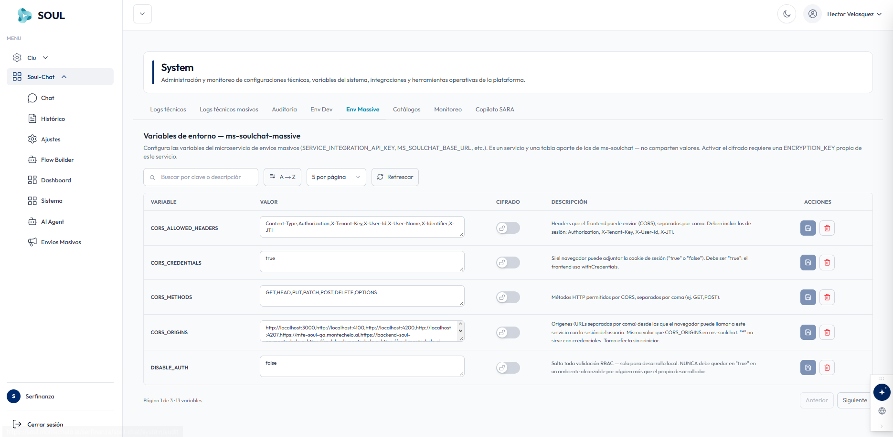

En la pestaña **Env Massive** configuras las variables de entorno del microservicio de envíos masivos, **ms-soulchat-massive**, como `SERVICE_INTEGRATION_API_KEY` o `MS_SOULCHAT_BASE_URL`.

<Info>
  Este microservicio tiene su propia tabla de variables, separada de la de **ms-soulchat** (pestaña [Env Dev](/soulchat/sistema/env-dev)). Las dos tablas **no comparten valores**: si una variable existe en ambos servicios, debes configurarla en cada uno.
</Info>

## Barra de control

- **Buscador**: campo **Buscar por clave o descripción** para localizar rápidamente cualquier variable.
- **Ordenamiento**: botón para ordenar alfabéticamente **A → Z**.
- **Paginación y recarga**: selector de registros visibles (5 por página) y botón **Refrescar** para sincronizar los valores con el servidor.

## Tabla de variables de entorno

| Columna | Descripción |
| --- | --- |
| **Variable** | Clave técnica en mayúsculas (ej. `CORS_ALLOWED_HEADERS`, `CORS_ORIGINS`, `DISABLE_AUTH`). |
| **Valor** | Campo editable para ingresar o actualizar el dato (listas separadas por comas, URLs, flags booleanos, API keys). |
| **Cifrado** | Interruptor con icono de candado para encriptar datos confidenciales. Requiere una `ENCRYPTION_KEY` **propia de este servicio**. Las variables cifradas ocultan su contenido y solo admiten sobreescritura. |
| **Descripción** | Texto explicativo sobre el uso, sintaxis esperada o consideraciones técnicas de la variable. |
| **Acciones** | **Guardar** (icono de disquete) para persistir cambios individuales. **Eliminar** (papelera) para remover la variable del entorno. |

## Variables destacadas

| Variable | Valor esperado | Descripción |
| --- | --- | --- |
| `CORS_ALLOWED_HEADERS` | Lista separada por comas | Headers que el frontend puede enviar. Debe incluir los de sesión: `Authorization`, `X-Tenant-Key`, `X-User-Id` y `X-JTI`. |
| `CORS_CREDENTIALS` | `true` | Indica si el navegador puede adjuntar la cookie de sesión. Debe ser `true`, porque el frontend usa `withCredentials`. |
| `CORS_METHODS` | Lista separada por comas | Métodos HTTP permitidos, por ejemplo `GET,HEAD,PUT,PATCH,POST,DELETE,OPTIONS`. |
| `CORS_ORIGINS` | URLs separadas por comas | Orígenes desde los que el navegador puede llamar al servicio con la sesión del usuario. Debe tener el mismo valor que `CORS_ORIGINS` en ms-soulchat. El comodín `*` no funciona con credenciales. El cambio aplica sin reiniciar. |
| `DISABLE_AUTH` | `false` | Salta toda la validación RBAC. Solo para desarrollo local. |

<Warning>
  `DISABLE_AUTH` **nunca** debe quedar en `true` en un ambiente al que pueda acceder alguien distinto del propio desarrollador.
</Warning>

## Paginación inferior

Al final de la tabla se muestra la posición actual (por ejemplo, **Página 1 de 3 · 13 variables**) junto con los botones **Anterior** y **Siguiente** para navegar entre páginas.

<Warning>
  Modificar variables de CORS o API keys de integración puede interrumpir los envíos masivos activos. Realiza cambios en horarios de baja actividad y coordina con el equipo técnico.
</Warning>
